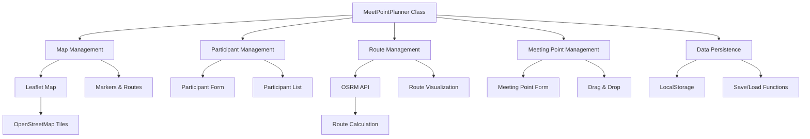
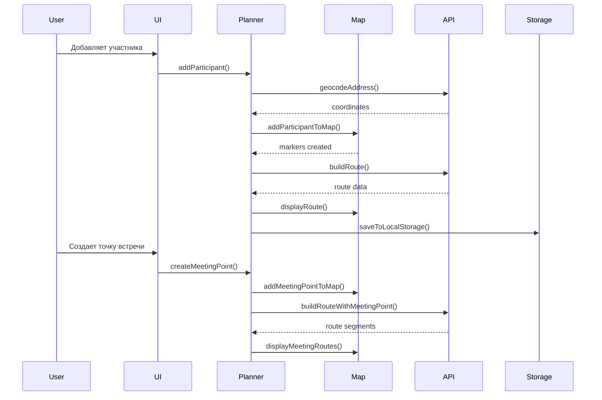
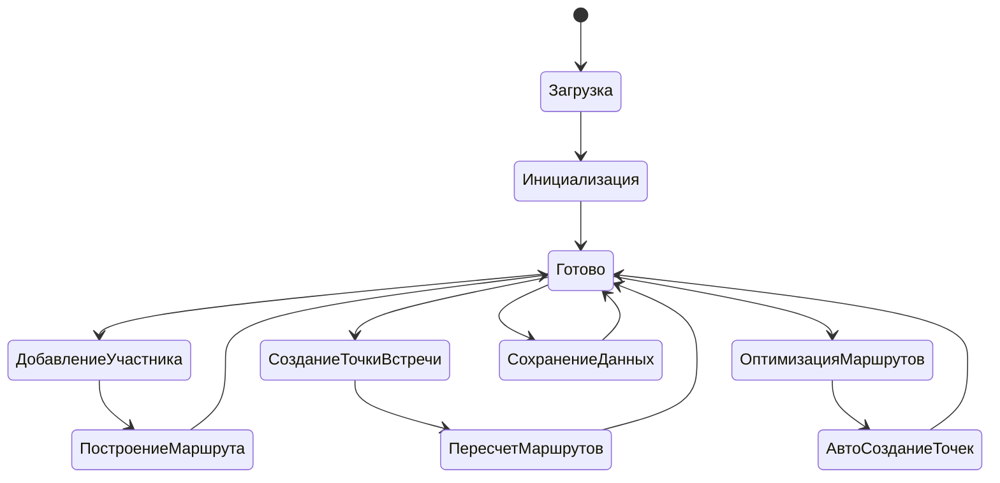

# MeetPoint Planner

## 📋 Описание проекта

**MeetPoint Planner** — это веб-приложение для организации совместных поездок, которое упрощает планирование маршрутов за счет визуализации и автоматизации поиска оптимальных точек встречи.

### 🎯 Цель проекта
Упростить организацию совместных поездок за счет визуализации маршрутов и автоматизации поиска точек встречи.

### ✨ Ключевые функции
- **Интерактивная карта** с возможностью добавления меток
- **Управление участниками** с указанием стартовых точек и наличия транспорта
- **Автоматическое построение маршрутов** с учетом типа транспорта (автомобиль/пешком)
- **Система точек встречи** с drag-and-drop функциональностью
- **Оптимизация маршрутов** для совместных поездок
- **Сохранение и загрузка** данных в браузере

---

## 📁 Структура проекта

```
MeetPoint Planner/
├── index.html          # Главная HTML-страница
├── styles.css          # Стили приложения
├── script.js           # Основная логика приложения
└── README.md           # Документация проекта
```

---

## 📄 Описание файлов

### `index.html`
**Назначение:** Главная HTML-страница приложения

**Ключевые элементы:**
- Структура интерфейса с боковой панелью и картой
- Формы для добавления участников и точек встречи
- Элементы управления картой и статистики

**Связи с другими файлами:**
- Подключает `styles.css` для стилизации
- Подключает `script.js` для функциональности
- Использует внешние библиотеки: Leaflet, Font Awesome, Inter Font

**Логика:**
Создает двухпанельный интерфейс:
- **Левая панель:** Формы управления и списки
- **Правая панель:** Интерактивная карта с элементами управления

### `styles.css`
**Назначение:** Стилизация пользовательского интерфейса

**Ключевые стили:**
- Современный дизайн с градиентами и эффектами размытия
- Адаптивная верстка с flexbox
- Кастомные компоненты (кнопки, формы, маркеры)
- Анимации и переходы

**Связи с другими файлами:**
- Применяется к элементам из `index.html`
- Поддерживает классы, создаваемые в `script.js`

**Логика:**
Использует CSS3 с современными возможностями:
- `backdrop-filter` для эффектов размытия
- CSS Grid и Flexbox для компоновки
- CSS переменные для цветовой схемы
- Адаптивные медиа-запросы

### `script.js`
**Назначение:** Основная логика приложения

**Ключевые классы и функции:**

#### Класс `MeetPointPlanner`
Основной класс приложения, содержащий всю логику.

**Основные методы:**
- `init()` - инициализация приложения
- `initMap()` - настройка карты Leaflet
- `addParticipant()` - добавление участника
- `buildRoute()` - построение маршрута
- `createMeetingPoint()` - создание точки встречи
- `optimizeRoutes()` - оптимизация маршрутов

**Связи с другими файлами:**
- Управляет DOM-элементами из `index.html`
- Применяет стили из `styles.css`
- Интегрируется с внешними API (OSRM, Nominatim)

**Логика:**
Реализует архитектуру MVC:
- **Model:** Данные участников, маршрутов, точек встречи
- **View:** Обновление DOM и карты
- **Controller:** Обработка событий и бизнес-логика

---

## 🏗️ Архитектура проекта

### Общая структура



### Потоки данных



---

## 📚 Библиотеки/фреймворки

### Leaflet.js (v1.9.4)
**Назначение:** Интерактивная картография
**Где используется:**
- Основная карта приложения
- Маркеры участников и точек встречи
- Визуализация маршрутов
- Drag-and-drop функциональность

### Font Awesome (v6.4.0)
**Назначение:** Иконки интерфейса
**Где используется:**
- Кнопки и элементы управления
- Индикаторы статуса
- Навигационные элементы

### Inter Font
**Назначение:** Типографика
**Где используется:**
- Основной шрифт всего приложения
- Заголовки и текст

### Внешние API

#### OSRM (Open Source Routing Machine)
**Назначение:** Расчет маршрутов
**Где используется:**
- Построение оптимальных путей между точками
- Расчет времени и расстояния
- Поддержка разных типов транспорта (автомобиль/пешком)

#### Nominatim (OpenStreetMap)
**Назначение:** Геокодирование адресов
**Где используется:**
- Преобразование адресов в координаты
- Обратное геокодирование координат в адреса
- Поиск местоположений

---

## 🚀 Точка входа и запуск

### Как запускается проект
1. **Открытие файла:** `index.html` в веб-браузере
2. **Загрузка ресурсов:** CSS, JavaScript, внешние библиотеки
3. **Инициализация:** Создание экземпляра класса `MeetPointPlanner`
4. **Настройка карты:** Инициализация Leaflet с OpenStreetMap
5. **Загрузка данных:** Восстановление сохраненных данных из LocalStorage

### Что выполняется первым

```mermaid
flowchart TD
    A[Загрузка index.html] --> B[Подключение стилей и скриптов]
    B --> C[DOMContentLoaded Event]
    C --> D[Создание MeetPointPlanner]
    D --> E[init() метод]
    E --> F[initMap()]
    E --> G[bindEvents()]
    E --> H[loadFromLocalStorage()]
    E --> I[updateStats()]

    F --> J[Создание карты Leaflet]
    F --> K[Добавление тайлов OpenStreetMap]
    F --> L[Настройка обработчиков кликов]
    F --> M[Добавление легенды маршрутов]

    G --> N[Привязка обработчиков событий]
    H --> O[Загрузка сохраненных данных]
    I --> P[Обновление статистики]
```

---

## 🏛️ Архитектурные особенности

### Нестандартные решения

#### 1. Глобальная конечная точка
**Особенность:** Все участники имеют общую конечную точку
**Причина:** Упрощает планирование групповых поездок
**Реализация:** Единый маркер на карте, обновляющий маршруты всех участников

#### 2. Дифференцированные маршруты
**Особенность:** Разные типы маршрутов для пешеходов и водителей
**Причина:** Реалистичное планирование с учетом возможностей участников
**Реализация:**
- Разные API-профили (driving/foot-walking)
- Визуальное различие (сплошные/пунктирные линии)
- Разная толщина линий

#### 3. Интерактивное создание точек встречи
**Особенность:** Drag-and-drop для точек встречи с автоматическим пересчетом маршрутов
**Причина:** Интуитивное планирование и быстрая оптимизация
**Реализация:** События `dragstart` и `dragend` с перестроением маршрутов

### Причины выбора архитектуры

#### 1. Модульная структура
**Преимущества:**
- Легкость поддержки и расширения
- Четкое разделение ответственности
- Возможность тестирования отдельных компонентов

#### 2. Использование современных веб-технологий
**Преимущества:**
- Нативная производительность браузера
- Отсутствие зависимостей от фреймворков
- Простота развертывания

#### 3. Интеграция с открытыми API
**Преимущества:**
- Бесплатное использование
- Высокая точность данных
- Надежность и стабильность

---

## 🔧 Технические детали

### Структура данных

#### Участник (Participant)
```javascript
{
    id: number,           // Уникальный идентификатор
    name: string,         // Имя участника
    startPoint: string,   // Адрес стартовой точки
    endPoint: string,     // Адрес конечной точки
    startCoords: [lat, lng], // Координаты старта
    endCoords: [lat, lng],   // Координаты финиша
    hasCar: boolean,      // Наличие автомобиля
    color: string,        // Цвет маркера и маршрута
    distance: string,     // Расстояние маршрута
    duration: number      // Время в пути (минуты)
}
```

#### Точка встречи (Meeting Point)
```javascript
{
    id: number,           // Уникальный идентификатор
    name: string,         // Название/адрес
    coords: [lat, lng],   // Координаты
    participantIds: number[] // ID связанных участников
}
```

### Алгоритмы

#### Построение маршрута
1. **Валидация координат** участника
2. **Формирование waypoints** (старт → точка встречи → финиш)
3. **Запрос к OSRM API** с учетом типа транспорта
4. **Визуализация маршрута** на карте
5. **Обновление статистики** участника

#### Оптимизация маршрутов
1. **Поиск водителей** среди участников
2. **Поиск пешеходов** в радиусе 5 км от водителей
3. **Создание точек встречи** на середине пути
4. **Пересчет маршрутов** через точки встречи

---

## 📱 Пользовательский интерфейс

### Основные экраны

#### 1. Главный экран
- **Боковая панель:** Формы управления и списки
- **Карта:** Интерактивная карта с маркерами и маршрутами
- **Панель статистики:** Количество участников и точек встречи

#### 2. Добавление участника
- **Форма:** Имя, стартовая точка, наличие машины
- **Валидация:** Проверка заполнения полей
- **Геокодирование:** Автоматическое определение координат

#### 3. Создание точки встречи
- **Выбор участников:** Чекбоксы для выбора
- **Указание места:** Адрес или выбор на карте
- **Визуализация:** Маркер с возможностью перетаскивания

### Интерактивные элементы

#### Маркеры
- **Участники:** Цветные круги с именами
- **Точки встречи:** Специальные иконки 🤝
- **Конечная точка:** Маркер 🎯

#### Маршруты
- **Автомобильные:** Сплошные линии (толщина 5px)
- **Пешеходные:** Пунктирные линии (толщина 3px)
- **Общие участки:** Выделенные линии (#667eea)

---

## 🔄 Жизненный цикл приложения



---

## 🚀 Развертывание

### Требования
- Современный веб-браузер с поддержкой ES6+
- Доступ к интернету для загрузки внешних ресурсов

### Запуск
1. Скачайте все файлы проекта
2. Откройте `index.html` в браузере
3. Приложение готово к использованию

### Поддерживаемые браузеры
- Chrome 60+
- Firefox 55+
- Safari 12+
- Edge 79+

---

## 🔮 Возможности расширения

### Планируемые функции
- **Экспорт маршрутов** в различные форматы
- **Интеграция с календарями** для планирования времени
- **Уведомления** о времени отправления
- **Статистика поездок** и оптимизация
- **Мобильное приложение** на основе веб-версии

### Технические улучшения
- **PWA (Progressive Web App)** для офлайн-работы
- **Web Workers** для фоновых вычислений
- **Service Workers** для кэширования
- **WebSocket** для реального времени

---

---

Автор: legenda  
Telegram: [@LEGENDA_SD](https://t.me/LEGENDA_SD)
